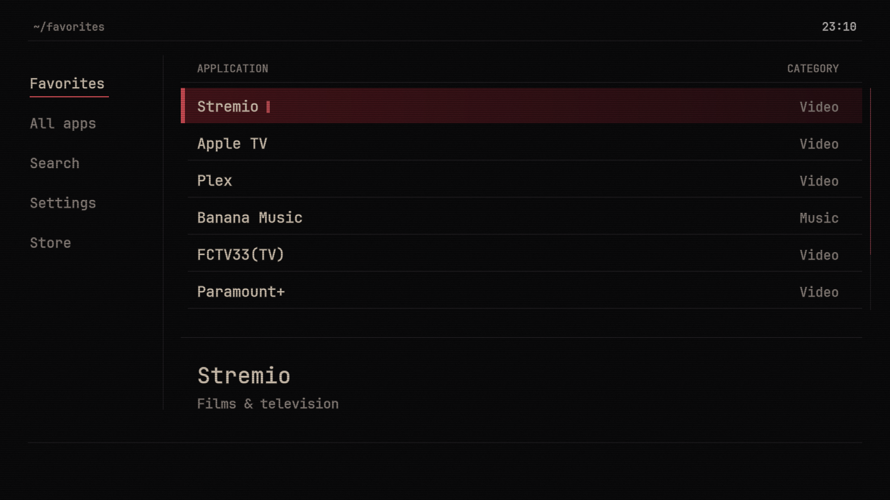
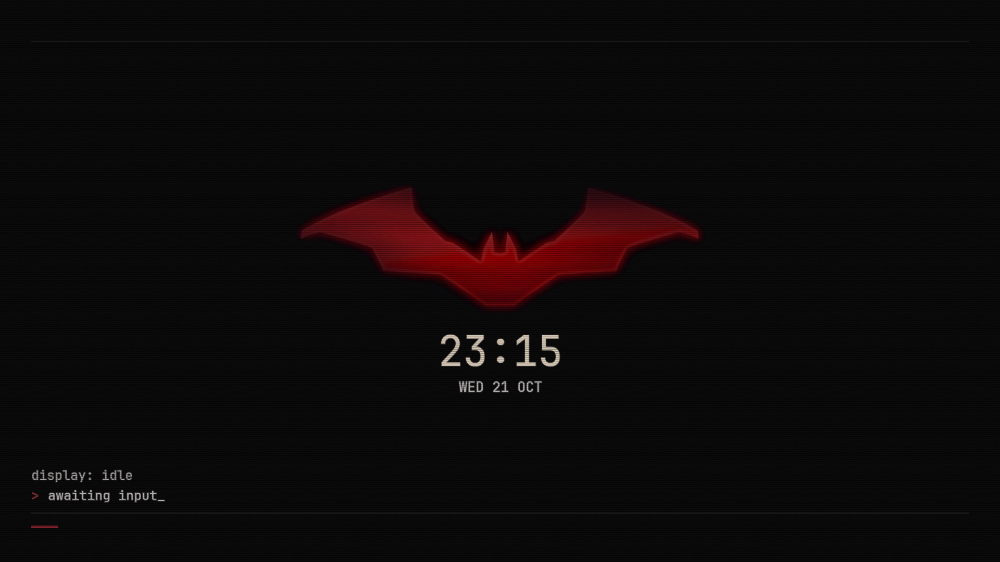

# Batcomputer TV

**What if your Android TV was the Batcomputer?**

A native Android TV launcher with the feel of a quiet terminal: near-black surfaces, muted red accents, warm phosphor lettering, and a shaded bat emblem when the screen goes idle.

No ads. No recommendation feed. Just your apps.



## The interface

- **Three layouts:** Command Line, File Browser, and Quiet Console. Search and Settings keep the selected layout.
- **Favorites and pins:** hold OK on an app to add it to Favorites or pin it to the top. Choices stay on the device.
- **Local search:** find installed apps by name or package, including sideloaded apps with a launchable activity.
- **Direct access:** Play Store and Android Settings are available from the launcher.
- **Terminal finish:** static scanlines, grain, phosphor-style text, and short focus transitions. Texture can be turned off.
- **Idle screen:** the original shaded emblem, clock, and date, available inside Home and as an Android screensaver.

Built with Java and Android's native Canvas APIs. No WebView, bundled web runtime, third-party application framework, analytics, or Internet permission. App discovery runs off the UI thread and the catalog is cached locally. Decorative effects do not need a continuous animation loop.



Screenshots show the development installation. A fresh install discovers your own apps; favorites start empty. The emblem is cropped from a supplied reference, preserving its proportions and soft edges. No generated artwork is used.

## Remote controls

| Action | Control |
| --- | --- |
| Select an app or setting | Up / Down |
| Open an app; cycle a setting | OK |
| Favorite, pin, or open app info | Hold OK on an app |
| Reach navigation from a list or Settings | Left / Right |
| Move between Quiet Console grid columns | Left / Right; outer edge reaches navigation |
| Move through bottom tabs | Left / Right, then OK; Up returns to content |
| Move through File Browser sidebar | Up / Down, then OK; Right returns to content |
| Return to apps | Back |

## Build

Requires macOS or Linux, JDK 17 or newer, Android SDK platform 35, Android build-tools 35.0.0, Bash, `zip`, and `openssl`. The build has been checked with JDK 21.

Install the SDK components using Android Studio's SDK Manager or the command-line SDK tools:

```sh
sdkmanager "platforms;android-35" "build-tools;35.0.0"
export ANDROID_SDK_ROOT="/path/to/your/android-sdk"
export JAVA_HOME="/path/to/your/jdk"
bash scripts/test.sh
bash scripts/build.sh
```

Output: `dist/Batcomputer-TV-0.1.0.apk`.

The first build generates a local signing key under `.local/signing/`, excluded from Git. Keep that directory privately backed up: subsequent APK updates must use the same key. Builds from different checkouts or CI runs have different keys unless you preserve that directory. Do not commit or share its contents.

## Install

Android TV 8.0 / API 26 or newer is required. Installation and default Home selection depend on the device manufacturer.

```sh
adb install -r dist/Batcomputer-TV-0.1.0.apk
```

Open **Batcomputer TV** from your apps. Where supported, select it as the default Home app in Android Settings or the Home chooser. Some TV firmware restricts third-party Home selection; this project does not bypass that restriction.

The source is standalone. It includes no launcher-specific switching, component disabling, recovery scripts, or dependency on another launcher. Installing it does not remove Android services or affect Google account sign-in, casting, voice search, or APK installation.

### Optional system screensaver integration

The Home idle screen works without special access. You can also select **Terminal** in Android's screensaver settings if your device exposes that menu.

To let the launcher's **Idle screen** setting select the system screensaver automatically, grant this optional Android permission:

```sh
adb shell pm grant io.github.amlfarhad.batcomputertv android.permission.WRITE_SECURE_SETTINGS
```

This is a privileged settings permission. The app uses it only to set `screensaver_components`, choosing Terminal or Google Ambient while Batcomputer TV is the default Home. Google Ambient must be installed for that option. Without the grant, the setting still controls the Home idle screen; it does not change the system screensaver. No other secure settings are modified.

## Project structure

```text
app/src/main/java/   Native launcher, navigation, drawing, and screensaver
app/src/main/assets/ Emblem and JetBrains Mono
app/src/main/res/    Theme and launcher artwork
tests/              Pure Java navigation and selection checks
scripts/            SDK build and test entry points
docs/images/        Development screenshots
```

The personal development build was used on an ONN Android TV stick. This public edition has a separate package ID (`io.github.amlfarhad.batcomputertv`); building it does not update that personal installation. Unit checks cover navigation and selection logic, not every firmware's Home behavior.

## Credits

An unofficial fan project by [Amal Farhad](https://github.com/amlfarhad). Batman artwork and marks belong to their respective rights holders; this project is not affiliated with DC or Warner Bros. JetBrains Mono is included under the SIL Open Font License. See [third-party notices](THIRD_PARTY_NOTICES.md).
